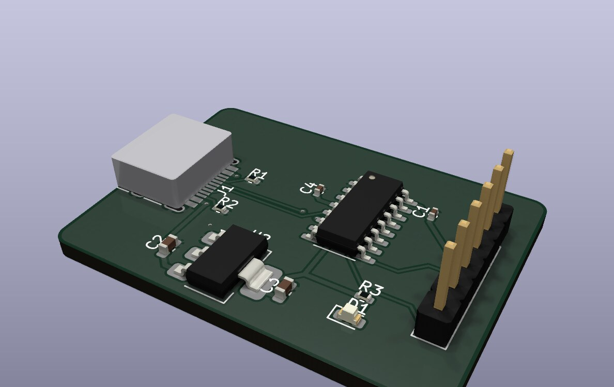
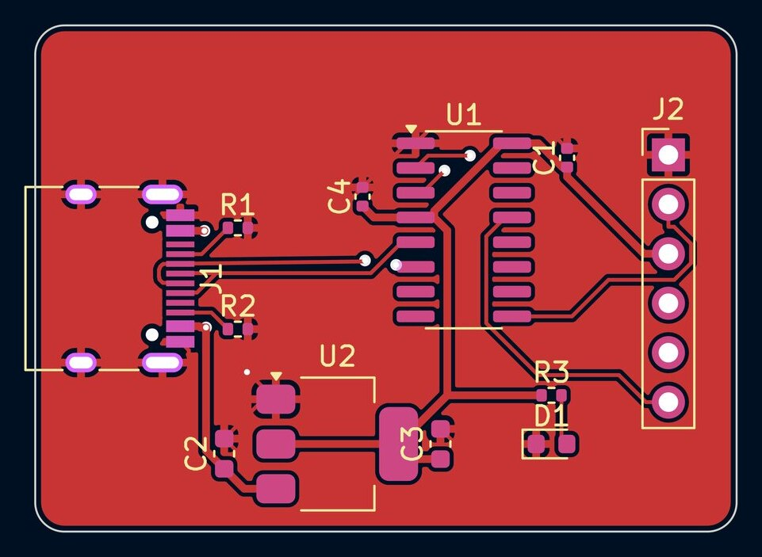
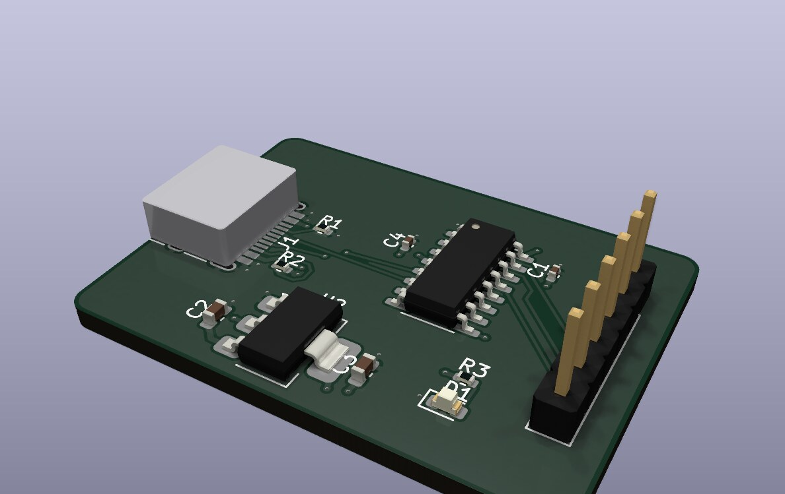
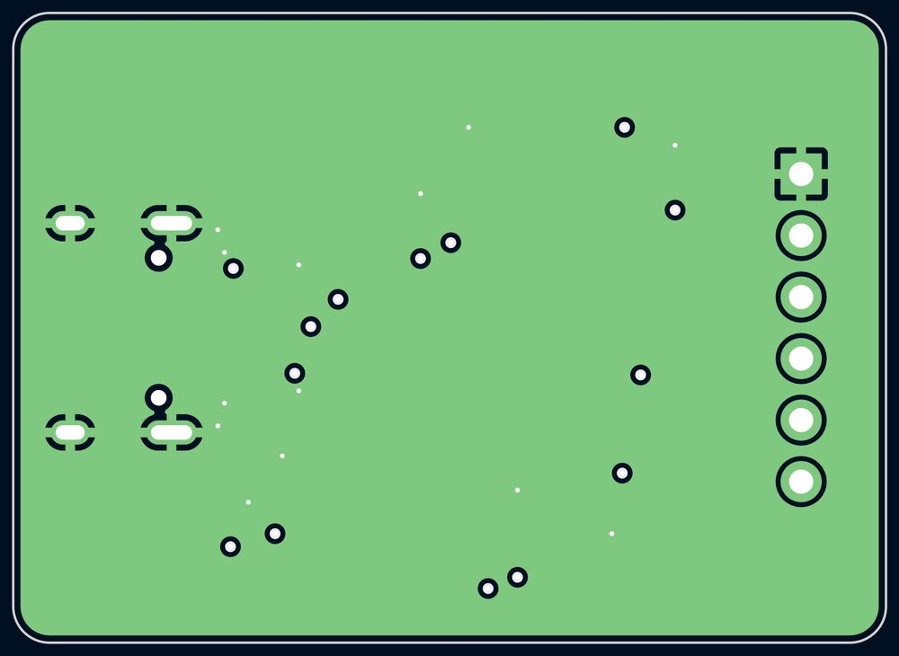
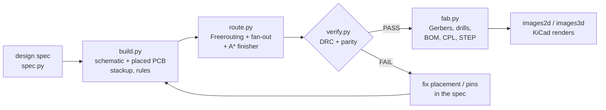

<div align="center">

# PCBDESIGNER_SKILL_JGIR

**A PCB engineering skill for Claude, with a KiCad automation toolkit that takes a design spec all the way to a routed, DRC-checked, JLCPCB-ready board.**

[](https://github.com/jeetashgir786786/PCBDESIGNER_SKILL_JGIR/actions/workflows/ci.yml)
[](https://github.com/jeetashgir786786/PCBDESIGNER_SKILL_JGIR/releases)
[](LICENSE)


 

<sub>The bundled example: a USB-C → 3.3 V UART bridge, generated from a ~60-line spec, autorouted and verified by one command (<code>pipeline.sh</code>). The images are KiCad's own 3D view and the routed top copper.</sub>

</div>

---

## Contents
- [What it is](#what-it-is)
- [Features](#features)
- [Gallery](#gallery)
- [Install](#install)
- [Using the skill](#using-the-skill)
- [KiCad automation toolkit](#kicad-automation-toolkit)
- [Measured results](#measured-results)
- [Repository layout](#repository-layout)
- [Design principles](#design-principles)
- [Limitations](#limitations)
- [Roadmap](#roadmap)
- [Contributing](#contributing) · [License](#license) · [Citation](#citation)

## What it is

PCBDESIGNER_SKILL_JGIR is an [Agent Skill](https://platform.claude.com/docs/en/agents-and-tools/agent-skills/overview): a folder of instructions, reference material and scripts that Claude loads when a task involves PCB design. It has two layers.

1. **Engineering knowledge.** A gated design process from requirements to handoff, plus 25 reference files covering stackups from 2 to 32 layers, HDI and microvias, signal and power integrity, EMC, RF, high-voltage creepage, flex, and DFM/DFA/DFT. It also includes a calculator for impedance, delay, current, PDN, stub resonance and spacing. Every claim must be labelled `VERIFIED`, `ASSUMPTION` or `UNVERIFIED`, and nothing may be called "DRC-clean" or "tested" unless it was.
2. **Automation toolkit** (`scripts/kicad_auto/`). One command runs: a Python design spec → KiCad schematic and placed PCB → **[Freerouting](https://github.com/freerouting/freerouting) autorouting** with plane fan-out and an A* finishing router → DRC and netlist parity checks → Gerbers, drills, BOM and CPL → real KiCad 2D and 3D images.

## Features

| Area | Included |
|---|---|
| Design process | 11 gates from intake to handoff, with stop/go criteria; task modes from a quick question to a full design |
| Stackups | 2–32 layer guidance, symmetric construction, layer assignment, impedance targets, back-drill planning |
| Signal integrity | Impedance, loss, return paths, crosstalk, via stubs; interface rules for USB, PCIe 3–7, DDR4/5, Ethernet, HDMI, MIPI, SerDes |
| Power | PDN target impedance, decoupling, IR drop, via current; hot-loop and gate-drive layout for power electronics |
| Compliance | EMC/ESD, functional (IPC-2221) vs safety (IEC 62368-1 / 60664-1) spacing, standards map |
| Manufacturing | Fab capability snapshots (dated), IPC-4761 via protection, DFM/DFA/DFT checklists, output packages |
| Calculator | `pcb_calc.py`: 16 commands, each formula stated and labelled as an estimate |
| KiCad automation | Spec → schematic + PCB → autoroute → verify → fab → images, stopping at the first failed check |
| Evaluation | 22 scored test cases plus a scoring rubric for benchmarking against baseline Claude |

## Gallery

| | |
|---|---|
|  |  |
| Same example built as a 4-layer board (`LAYERS=4`) | Its inner GND plane, connected by automatic fan-out vias |

## Install

**Claude apps (claude.ai, desktop, mobile)**
1. Download `pcbdesigner-skill-jgir-vX.Y.Z.zip` from the [latest release](https://github.com/jeetashgir786786/PCBDESIGNER_SKILL_JGIR/releases/latest).
2. In Claude, open **Settings → Capabilities → Skills** and upload the ZIP. Skills must be enabled for your account.

**Claude Code**
```bash
git clone https://github.com/jeetashgir786786/PCBDESIGNER_SKILL_JGIR.git
mkdir -p ~/.claude/skills
cp -r PCBDESIGNER_SKILL_JGIR/pcbdesigner-skill-jgir ~/.claude/skills/
```

**Other agents.** Use `SKILL.md` as the system or instruction file and the `references/` folder as knowledge files.

Full details are in [docs/installation.md](docs/installation.md).

## Using the skill

Once installed, the skill loads automatically for PCB tasks. Some prompts that exercise it:

```text
Review this KiCad schematic for an ESP32-S3 board: power, decoupling, boot/reset, USB and ESD.
Plan a 10-layer stackup for an FPGA + DDR4 board at JLCPCB, with 50 Ω SE / 100 Ω diff targets.
What via structure do I need to escape a 0.4 mm-pitch BGA, and what does it cost in fab complexity?
Design and route a USB-C powered 3.3 V UART bridge for JLCPCB PCBA and give me the fab files.
Calculate the trace width for 4 A on an outer 1 oz layer with a 20 °C rise, and show your assumptions.
```

More examples are in [docs/usage.md](docs/usage.md) and [`examples/example-briefs.md`](pcbdesigner-skill-jgir/examples/example-briefs.md).

## KiCad automation toolkit



```bash
cd pcbdesigner-skill-jgir/scripts/kicad_auto
python3 check_env.py                 # what is installed, what is missing
bash get_freerouting.sh              # official Freerouting v1.9.0 jar from GitHub releases
./pipeline.sh examples/usb_uart_spec.py /tmp/usb_uart 20 1
```

Expected output, abridged:
```text
== route   [done] 35s  unconnected=0  errors=0
== verify  DRC unconnected=0 errors=0 · board parity 62 pads, 0 problems · sch parity 49 pins, 0 problems · RESULT PASS
== fab     zip USB_UART_Bridge_Gerbers_JLCPCB.zip · BOM/CPL written; 8 BOM lines need an LCSC check
ALL GATES PASSED (ERC still to run in the GUI on KiCad 7)
```

The full workflow, every gate, a troubleshooting order for open nets, and a table of pitfalls the code already handles are in **[references/kicad-automation.md](pcbdesigner-skill-jgir/references/kicad-automation.md)**.

## Measured results

KiCad 7.0.11, Freerouting 1.9.0, one CPU thread, November 2026.

| Board | Result | Routing time |
|---|---|---|
| Example USB-UART bridge, 2-layer, 12 parts | 0 unconnected · 0 DRC errors · verification PASS | ~40 s |
| Same board, 4-layer (GND + 3V3 planes) | 0 unconnected · 0 DRC errors · verification PASS | ~35 s |
| Dense MCU board, 30×30 mm, 4-layer, ~70 parts, 0.5 mm-pitch LGA sensor, re-routed from scratch with no help | 1 open connection · 0 DRC errors | ~4 min |

On dense boards the last one or two connections usually need a placement change or a pin swap; the docs give a step-by-step order for fixing them. The benchmark against baseline Claude is in progress; the method is in [`evals/`](pcbdesigner-skill-jgir/evals).

## Repository layout

```text
PCBDESIGNER_SKILL_JGIR/
├── pcbdesigner-skill-jgir/          ← the skill (this folder is what gets zipped and installed)
│   ├── SKILL.md                     ← entry point: mission, rules, gates, reference router
│   ├── references/                  ← 25 topic references (stackups, SI, PI, EMC, RF, HDI, DFM, KiCad …)
│   ├── scripts/
│   │   ├── pcb_calc.py              ← engineering calculator
│   │   └── kicad_auto/              ← spec → routed → verified → fab-ready KiCad toolkit
│   ├── templates/                   ← requirements, stackup, review and handoff templates
│   ├── evals/                       ← test cases + scoring rubric
│   └── examples/                    ← example design briefs
├── docs/                            ← installation, usage, architecture, images
├── tests/                           ← pytest suite (runs without KiCad)
├── tools/package_skill.py           ← validate + build the release ZIP
└── .github/                         ← CI, release workflow, issue/PR templates
```

## Design principles

- **Honest by default.** Datasheet values, ratings and fab capabilities are never invented. Unverified numbers are labelled, and fab capabilities are dated.
- **Calculations shown.** Equation → inputs with units → result → margin. Closed-form impedance is a first estimate; final values come from a field solver.
- **Gated work.** Full designs move through requirements, architecture, circuit design, parts, schematic, stackup, placement, routing, verification, manufacturing and handoff, without skipping steps.
- **Every gate reports its own evidence.** The automation prints tool version, counts and anything it did not run. That output goes into the handoff word for word.

## Limitations

- The toolkit is **tested on KiCad 7.0.11 only**. It uses the SWIG `pcbnew` API, which is deprecated in KiCad 9. Run the bundled example before trusting it on another version.
- The autorouter is not suitable for impedance-controlled pairs, RF feeds, switching-regulator hot loops or high-current paths. Route those by hand and run `route.py --keep`.
- ERC needs the KiCad GUI on version 7. `kicad-cli sch erc` exists only from version 8.
- LCSC part numbers in the helper library are flagged UNVERIFIED until you check them. CPL rotations need JLCPCB's placement preview.
- **AI-assisted designs still need review by a qualified engineer** before fabrication, especially for mains, high-energy, medical, automotive or aerospace work.

## Roadmap

- [ ] Verified on KiCad 8 and 9, plus a headless `kicad-cli pcb render` path tested in CI
- [ ] Live LCSC/JLCPCB part and stock lookup during BOM generation
- [ ] Published benchmark: skill vs baseline Claude vs other public PCB skills
- [ ] Differential-pair and length-matching aware routing stage
- [ ] KiCad integration test job in CI (container image)

## Contributing

Issues and pull requests are welcome. Read [CONTRIBUTING.md](CONTRIBUTING.md) first. Any change to `scripts/kicad_auto/` must keep the example passing `pipeline.sh`, and any new numeric claim in `references/` needs a source and a date.

## License

[MIT](LICENSE) © 2026 Jeetash Goswami.
Freerouting, KiCad and the KiCad libraries are separate projects under their own licenses. They are not bundled here.

## Citation

If this skill helps your work, please cite it using [CITATION.cff](CITATION.cff) (GitHub shows a "Cite this repository" button).

---

<sub>Independent project. Not affiliated with or endorsed by Anthropic, KiCad, Freerouting or JLCPCB.</sub>
